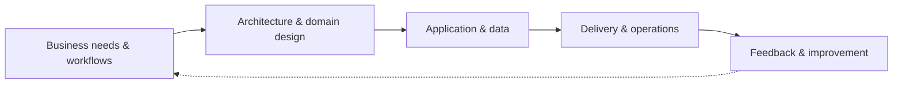

# 👋 Hi, I'm Supachai Nilcha
### Software Engineer · Full-Stack Development · Platform & Infrastructure

**Turning business needs into practical software, data platforms, and dependable delivery workflows.**

📍 Chonburi, Thailand  
[Explore my projects](https://github.com/picthaisky?tab=repositories) · [Portfolio](https://github.com/picthaisky/Portfolio) · [Get in touch](mailto:picthaisky00@gmail.com)

---

## 👨‍💻 About me

ผมทำงานด้าน Software Engineering และ IT Infrastructure โดยสนใจการเชื่อมโยง **ความต้องการทางธุรกิจ สถาปัตยกรรมระบบ การพัฒนา และการดูแลระบบ** ให้เป็นโซลูชันที่ทีมสามารถใช้งานและพัฒนาต่อได้

My background spans full-stack applications, API and database design, server infrastructure, and delivery practices. I enjoy working across the lifecycle—from understanding a workflow and shaping a solution to implementation, deployment, and ongoing improvement.

- 🧩 **Business applications:** workflows, dashboards, reporting, and operational tools
- 🛠️ **Full-stack engineering:** C#, ASP.NET Core, Angular, React, and TypeScript
- 🏗️ **Platform & operations:** Docker, Linux, deployment practices, monitoring, backup, and recovery
- 📊 **Exploration:** data platforms, analytics, AI-assisted development, and agent orchestration

## 🚀 Selected projects

Each repository has its own scope and maturity; explore the project documentation for implementation details and current status.

| Project | Problem and engineering focus | Technology / context |
|---|---|---|
| [**ECM Planning & Project Control**](https://github.com/picthaisky/ECM-Planning-Project-Control) | Construction project planning and control, including scheduling, progress and cost management. | .NET, React, TypeScript, domain-oriented architecture |
| [**POS SaaS System**](https://github.com/picthaisky/senic-pos-saas-system) | A retail and restaurant platform exploring sales, inventory and multi-tenant workflows. | ASP.NET Core, Angular, SQL Server |
| [**Job Service Marketplace**](https://github.com/picthaisky/Job-Service-Marketplace) | Connects service providers and customers; explores booking, commissions and tax-related workflows. | .NET, Angular, PostgreSQL |
| [**Slip Verification System**](https://github.com/picthaisky/slip-verification-system) | Payment-slip processing and verification workflows, with OCR-oriented design. | .NET, Angular, Python, PostgreSQL |
| [**Nexus-Agent**](https://github.com/picthaisky/Nexus-Agent) | Explores multi-agent orchestration and an interactive interface for observing agent activity. | Python, FastAPI, React, LangGraph |
| [**English Speaking Coach**](https://github.com/picthaisky/english-speaking-coach) | An English practice application concept with speech feedback and progress tracking. | .NET, Angular, speech and AI integration concepts |

### 🏢 Organization platform work

These public repositories present shared platform designs and reference implementations. They represent collaborative project work; see each repository for its scope, contributors and readiness.

- [**Enterprise Data Lakehouse Platform**](https://github.com/kingpac-dev/Enterprise-Data-Lakehouse-Platform) — a ClickHouse-based data platform example with ingestion, analytics, observability and deployment documentation. DEV/UAT and production readiness have distinct limits.
- [**Enterprise DevOps Blueprint**](https://github.com/kingpac-dev/enterprise-devops-blueprint) — reference architecture, standards, templates and runbooks for container-based delivery; a blueprint rather than a deployable platform.

> Projects include implementations, experiments and design documents. Features described in their READMEs should be evaluated against each repository's current implementation and validation status.

## 🏗️ Architecture & Delivery Expertise

> From business requirements to maintainable applications and operationally aware delivery.

| Perspective | Engineering focus | Value to the team |
|---|---|---|
| **Business & product** | Map stakeholders, workflows, requirements and acceptance criteria. | A shared understanding of the problem and priorities. |
| **Application architecture** | Design layered and domain-oriented applications, APIs and clear boundaries between responsibilities. | A foundation that is easier to change, test and understand. |
| **Data & integration** | Model relational data, reporting flows and system integrations; explore analytics with ClickHouse. | More consistent information for operations and decisions. |
| **Security by design** | Consider authentication, authorization, validation and secret handling throughout design and delivery. | Helps reduce avoidable security risks; controls still need verification. |
| **Delivery & operations** | Use containers, deployment documentation and environment-specific configuration; plan monitoring, backup and recovery. | More repeatable releases and clearer operational handover. |
| **Quality & collaboration** | Use reviewable changes, documentation and appropriate testing; communicate assumptions and trade-offs. | Makes decisions and follow-up work easier for the team. |

### 🔄 How I approach delivery

1. **Understand** — identify the business problem, users, constraints and desired outcomes.
2. **Design** — map workflows, define system boundaries, data models and API contracts.
3. **Build** — deliver in manageable increments, with security and maintainability in mind.
4. **Validate** — review behavior and run checks suited to the change and environment.
5. **Operate & improve** — document deployment and recovery, observe outcomes, and refine with feedback.

> The approach is adapted to each project's scope and maturity; not every practice is implemented in every repository.

## 💡 Areas of interest & impact

| Area | What I aim to enable | Explore |
|---|---|---|
| **Enterprise applications** | Replace fragmented workflows with clearer processes, role-based access and useful operational information. | [ECM Project Control](https://github.com/picthaisky/ECM-Planning-Project-Control) |
| **SaaS & digital products** | Explore reusable application architecture and workflows that can serve different users and businesses. | [POS SaaS](https://github.com/picthaisky/senic-pos-saas-system) · [Marketplace](https://github.com/picthaisky/Job-Service-Marketplace) |
| **Data & analytics** | Organize data flows and analytics foundations to support more informed decisions. | [Data Lakehouse Platform](https://github.com/kingpac-dev/Enterprise-Data-Lakehouse-Platform) |
| **Engineering platforms** | Define shared delivery practices, operational guidance and reusable templates. | [Enterprise DevOps Blueprint](https://github.com/kingpac-dev/enterprise-devops-blueprint) |
| **AI-assisted workflows** | Explore agent orchestration and human review as part of software and knowledge workflows. | [Nexus-Agent](https://github.com/picthaisky/Nexus-Agent) |

## 🛠️ Technology & engineering interests

| Area | Tools and practices |
|---|---|
| **Backend & APIs** | C#, ASP.NET Core, REST APIs, Entity Framework Core, Python |
| **Frontend** | Angular, React, TypeScript, Tailwind CSS, responsive UI |
| **Data** | SQL Server, PostgreSQL, ClickHouse, data modeling and analytics |
| **Delivery & infrastructure** | Docker, Linux, Nginx, IIS, Portainer, CI/CD concepts |
| **Architecture** | Layered design, domain modeling, access control, documentation and operational readiness |

## 💼 Professional background

| Period | Role | Focus |
|---|---|---|
| **2023–present** | Software Development Full Stack · Kings Pack Industrial | .NET and Angular applications, API and database design, internal systems |
| **2018–2022** | IT System Administrator · Sriracha Cancer Alliance Hospital | Server infrastructure, virtualization, backup and disaster recovery |
| **2014–2018** | IT Supervisor · Rest At 88 Co., Ltd. | IT operations, team coordination and technology planning |

## 🤝 Let's connect

สนใจแลกเปลี่ยนเรื่อง **Full-Stack Development, Enterprise Applications, DevOps, Data Platforms และ AI-assisted Engineering** ยินดีพูดคุยและร่วมสร้างสิ่งที่มีประโยชน์ครับ

[GitHub](https://github.com/picthaisky) · [Portfolio](https://github.com/picthaisky/Portfolio) · [Email](mailto:picthaisky00@gmail.com)

Build systems that are useful, maintainable, and ready to grow.

